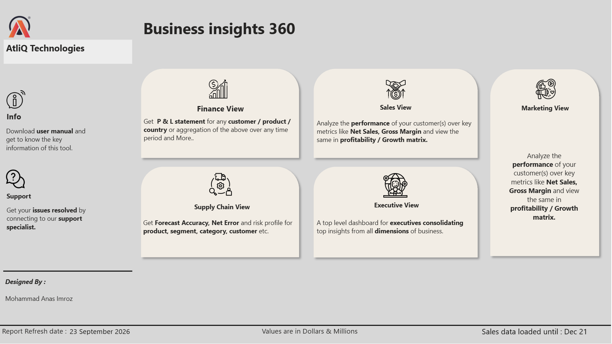
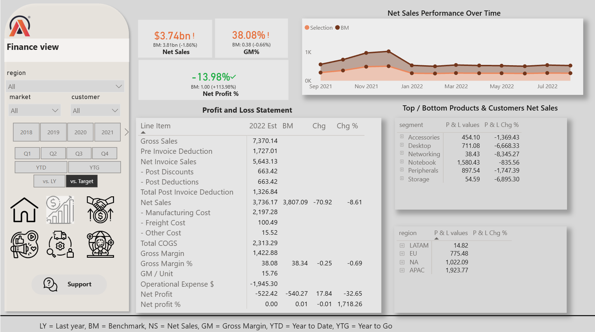
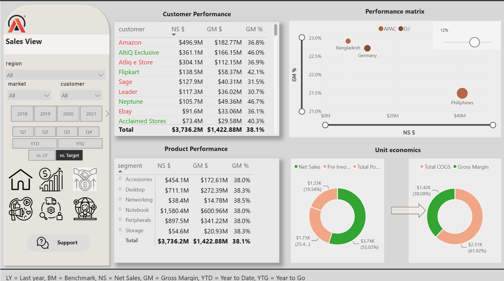
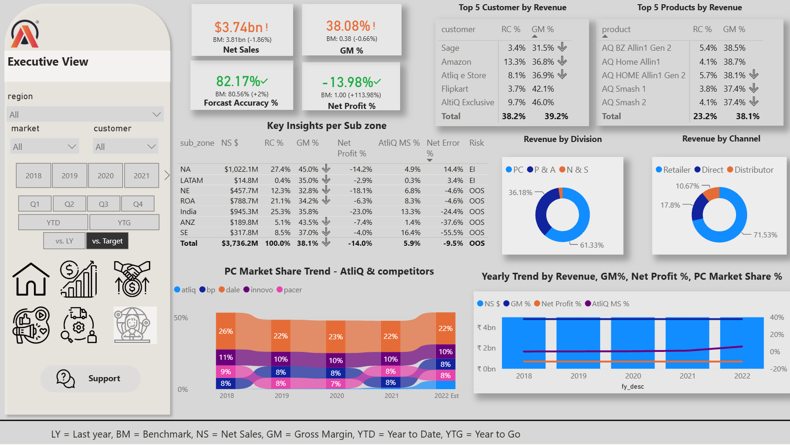

# AtliQ Hardwares – Business Insights 360

### End-to-End Business Intelligence Project | Power BI · SQL · DAX

**Turning business data into actionable insights for better decision-making.**

Business Insights 360 is an end-to-end Business Intelligence project developed for AtliQ Hardwares, a fictional consumer electronics company headquartered in India with operations across multiple countries. Developed as part of the **Power BI Data Analytics Course by Codebasics**, this project demonstrates how data analytics can support decision-making across Finance, Sales, Marketing, Supply Chain, and Executive Management.

**[Explore the Interactive Power BI Dashboard](https://app.powerbi.com/view?r=eyJrIjoiYzYzODZkZWUtYTFkOC00Y2NkLWEzMzMtMTViYTAyYjcyYzlhIiwidCI6ImM2ZTU0OWIzLTVmNDUtNDAzMi1hYWU5LWQ0MjQ0ZGM1YjJjNCJ9)**

---

## Project Snapshot

| Category | Details |
|---|---|
| Project Type | End-to-End Business Intelligence |
| Business Domain | Finance, Sales, Marketing, Supply Chain |
| Primary Tool | Microsoft Power BI |
| Technologies | SQL, DAX, Power Query, Excel, DAX Studio |
| Data Model | Snowflake Schema |
| Data Sources | SQL databases and Excel workbooks |
| Dashboard Views | Home, Finance, Sales, Marketing, Supply Chain, Executive |
| Key Features | Interactive dashboards, KPI tracking, bookmarks, drill-through |
| Business Objective | Support data-driven decision-making across business functions |
| Developed As Part Of | Codebasics Power BI Data Analytics Course |

## Table of Contents

- [Business Problem](#business-problem)
- [Project Objectives](#project-objectives)
- [Technology Stack](#technology-stack)
- [Data Sources](#data-sources)
- [Data Modeling](#data-modeling)
- [Dashboard Overview](#dashboard-overview)
- [Key Technical Implementations](#key-technical-implementations)
- [Domain Knowledge](#domain-knowledge)
- [Business Impact](#business-impact)
- [Skills Demonstrated](#skills-demonstrated)
- [Project Resources](#project-resources)
- [Acknowledgements](#acknowledgements)

## Business Problem

AtliQ Hardwares relied heavily on Excel-based reporting to analyze its growing international business. As operations expanded, this approach became inefficient and made it difficult to generate timely, actionable insights.

The company also experienced significant losses in the Latin America region, highlighting the need for stronger analytical capabilities to understand business performance and support strategic decisions.

The key challenges included:

- **Fragmented reporting:** Business data was distributed across multiple sources.
- **Limited performance visibility:** Stakeholders lacked a consolidated view of key business KPIs.
- **Profitability analysis:** Understanding financial performance across customers, products, and markets was challenging.
- **Forecasting challenges:** The business needed better visibility into forecast accuracy and net forecast errors.
- **Strategic planning:** Leadership required market share insights and performance tracking to support business decisions.

### The Solution

An interactive Power BI reporting solution that integrates data from SQL databases and Excel workbooks into a centralized analytical experience, enabling stakeholders to explore business performance across five key functional areas.

## Project Objectives

- Consolidate business reporting into a unified Power BI solution.
- Analyze financial, sales, marketing, and supply chain performance.
- Track business performance against defined targets.
- Identify underperforming customers, products, and markets.
- Evaluate forecast accuracy and planning gaps.
- Provide role-specific dashboards for business stakeholders.
- Enable data-driven decision-making through interactive visualizations.

## Technology Stack

| Technology | Application |
|---|---|
| SQL | Data extraction and querying |
| Microsoft Excel | Integration of business targets and market share data |
| Power BI | Interactive dashboards and report development |
| DAX | Business measures, calculated columns, and KPI calculations |
| Power Query | Data transformation and preparation |
| DAX Studio | DAX analysis and performance optimization |
| Git & GitHub | Project documentation and version control |

## Data Sources

The project combines data from two SQL databases and supporting Excel workbooks.

### 1. SQL Database: `gdb041`

| Table | Description |
|---|---|
| `dim_customer` | Customer information |
| `dim_market` | Market and country-level information |
| `dim_product` | Product information |
| `fact_sales_monthly` | Monthly sales quantity |
| `fact_forecast_monthly` | Monthly forecasted quantity |

### 2. SQL Database: `gdb056`

| Table | Description |
|---|---|
| `freight_cost` | Freight and logistics costs |
| `gross_price` | Gross price by product |
| `manufacturing_cost` | Product manufacturing costs |
| `pre_invoice_deductions` | Discounts applied before invoicing |
| `post_invoice_deductions` | Post-invoice discounts and deductions |

### 3. Excel Workbooks

- **Targets:** Net sales, gross margin, and net profit targets by market.
- **Market Share:** AtliQ's and competitors' market share data.

These datasets provide the foundation for analyzing business performance across products, customers, markets, and time.

## Data Modeling

**Model Architecture: Snowflake Schema**

The data model integrates fact and dimension tables to support analytical reporting across multiple business dimensions.

Key modeling activities:

- Integrating data from multiple SQL databases and Excel workbooks.
- Establishing relationships between relevant tables.
- Organizing customer, product, market, and date dimensions.
- Developing reusable DAX measures for consistent KPI calculations.
- Structuring the model to support cross-functional reporting.

## Dashboard Overview

The report includes a centralized Home View with navigation to six functional sections.

### 1. ### Home View

Provides a unified entry point to the dashboard.

**Sections available:**

- Finance
- Sales
- Marketing
- Supply Chain
- Executive
- Information
- Support

**Business purpose:** Simplifies navigation and provides convenient access to role-specific insights.

### 2. Finance View — Financial Performance

Provides a comprehensive Profit & Loss view and financial analysis across customers, products, markets, and time.

**Key capabilities:**

- Profit & Loss statement analysis.
- Net Sales and Gross Margin tracking.
- Financial performance trends.
- Customer and product comparisons.
- Market-level financial analysis.

**Business purpose:** Helps stakeholders understand financial performance, evaluate profitability, and investigate areas requiring attention.

### 3. Sales View — Customer Performance

Focuses on customer-level sales and profitability.

**Key metrics:**

- Net Sales
- Gross Margin
- Gross Margin %

**Key capabilities:**

- Customer performance evaluation.
- Sales and profitability comparisons.
- Identification of customers with weaker gross margin performance.

**Business purpose:** Supports customer-level analysis and helps identify opportunities to improve profitability.

### 4. Marketing View — Product and Market Analysis

Provides a product-focused view of commercial performance and profitability.

**Key metrics:**

- Net Sales
- Gross Margin %
- Net Profit
- Net Profit %

**Key capabilities:**

- Product-level performance analysis.
- Market and product comparisons.
- Profitability analysis across business dimensions.

**Business purpose:** Helps stakeholders evaluate product performance and identify areas for further commercial investigation.

### 5. Supply Chain View — Forecast and Planning Analysis

Focuses on forecast accuracy and differences between forecasted and actual demand.

**Key capabilities:**

- Forecast accuracy analysis.
- Net forecast error analysis.
- Customer-wise comparisons against the previous year.
- Product-wise comparisons against the previous year.
- Identification of potential planning gaps.

**Business purpose:** Provides visibility into forecasting performance and supports demand-planning analysis.

### 6. Executive View — Strategic Business Overview

Consolidates key business KPIs for executive-level analysis.

**Key capabilities:**

- Consolidated business performance indicators.
- Market share analysis.
- High-level company performance overview.
- Cross-functional business visibility.

**Business purpose:** Helps leadership assess business performance, identify areas requiring attention, and support strategic planning.

## Key Technical Implementations

This project demonstrates practical application of Business Intelligence development techniques:

- **Data extraction:** Retrieving business data from relational SQL databases.
- **Data transformation:** Preparing and integrating data from multiple sources.
- **Data modeling:** Implementing a snowflake schema and establishing table relationships.
- **Advanced DAX:** Developing measures and calculations for business KPIs.
- **Interactive dashboards:** Enabling users to explore performance through report filters and visual interactions.
- **Bookmarks and navigation:** Creating a centralized, user-friendly report experience.
- **Drill-through:** Supporting deeper investigation of business performance.
- **Performance optimization:** Using DAX Studio to analyze DAX calculations.
- **Report publishing:** Making the interactive Power BI report available for exploration.

## Domain Knowledge

The project strengthened my understanding of how different business functions use data to monitor performance and support decisions.

| Business Domain | Concepts Applied |
|---|---|
| Financial Analytics | Profit & Loss, Net Sales, Gross Margin, Net Profit |
| Sales Analytics | Customer performance, sales trends, profitability |
| Marketing Analytics | Product performance, market share, Net Profit % |
| Supply Chain Analytics | Forecast accuracy, net forecast errors, demand planning |
| Executive Analytics | KPI monitoring, business performance, strategic analysis |

## Business Impact

The solution is designed to address reporting challenges and improve access to business insights.

- **Unified reporting:** Brings data from multiple sources into a centralized reporting experience.
- **Improved visibility:** Provides a consolidated view of financial and operational performance.
- **Profitability analysis:** Enables comparisons across customers, products, and markets.
- **Forecast monitoring:** Helps stakeholders investigate forecast accuracy and planning gaps.
- **Target tracking:** Supports analysis of performance against defined business targets.
- **Strategic decision support:** Presents relevant KPIs and market share insights for leadership.

*These are the intended business benefits of the solution. No quantified financial savings, revenue growth, or operational improvements are claimed.*

## Skills Demonstrated

### Technical Skills

- SQL data extraction and querying
- Power Query and data transformation
- Power BI report development
- Advanced DAX measures and calculations
- Snowflake schema data modeling
- KPI development and analysis
- DAX Studio performance analysis
- Interactive reporting, bookmarks, and drill-through
- Power BI report publishing
- Git and GitHub documentation

### Business and Analytical Skills

- Business requirement analysis
- KPI identification and definition
- Financial and profitability analysis
- Customer and product performance analysis
- Forecast accuracy analysis
- Market share analysis
- Data storytelling and visualization
- Translating business requirements into analytical reports

## Project Resources

### Interactive Power BI Report

Explore the published report and navigate through its different dashboard views.

**[Open Business Insights 360 on Power BI](https://app.powerbi.com/view?r=eyJrIjoiYzYzODZkZWUtYTFkOC00Y2NkLWEzMzMtMTViYTAyYjcyYzlhIiwidCI6ImM2ZTU0OWIzLTVmNDUtNDAzMi1hYWU5LWQ0MjQ0ZGM1YjJjNCJ9)**

### Power BI File

**[Download BI_360 - Report.pbix](https://drive.google.com/file/d/1fwyBtr4adQJkfIRUPNWqpFIhFqQjrYHA/view?usp=sharing)**

### Video Representation
**[watch video representation](https://drive.google.com/file/d/1oHdVw17GOs2tdu9OzZB6LpvC_jB0Gfkq/view?usp=sharing)

## Acknowledgements

This project was developed as part of the **Power BI Data Analytics Course by Codebasics**.

Special thanks to the Codebasics team for creating a practical, business-oriented learning experience focused on applying data analytics to real-world business requirements.

---

## Project Summary

| Detail | Description |
|---|---|
| Project | AtliQ Hardwares – Business Insights 360 |
| Category | Business Intelligence & Data Analytics |
| Primary Tool | Microsoft Power BI |
| Technologies | SQL, Excel, Power Query, DAX, DAX Studio |
| Data Model | Snowflake Schema |

**Turning data into insights. Turning insights into better decisions.**
